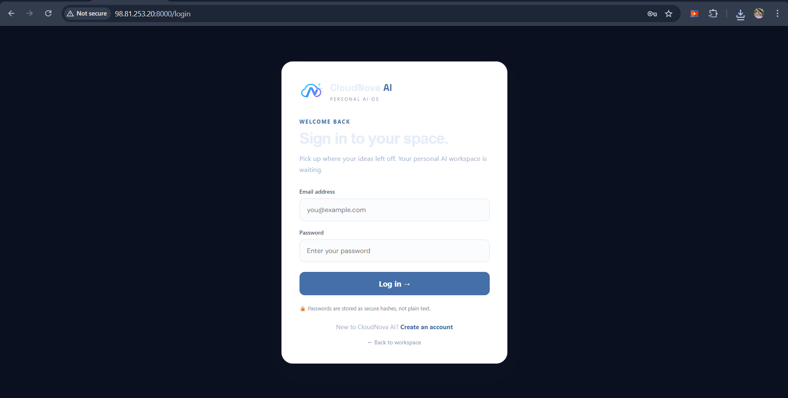
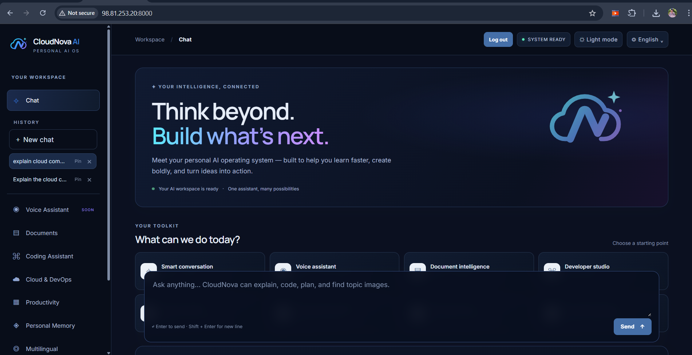
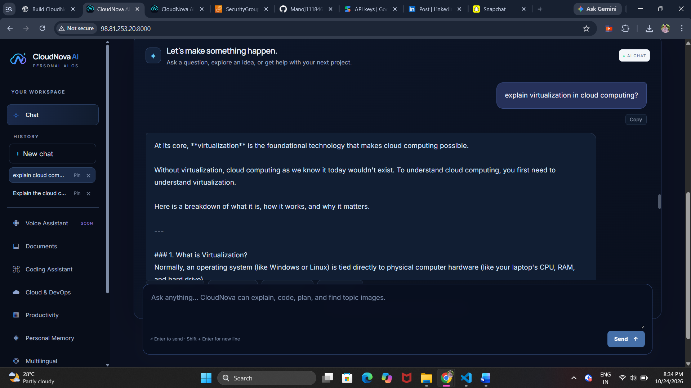
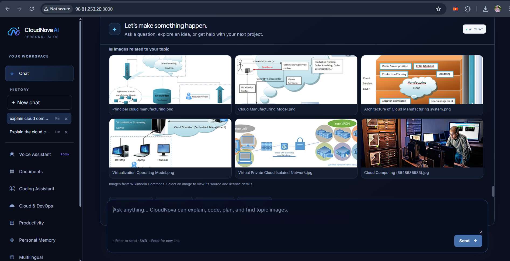

# ☁️ CloudNova AI — Your Personal AI OS

<p align="center">
  <strong>Think beyond. Build what's next.</strong><br>
  An AI-powered workspace for learning, coding, cloud computing, and productivity.
</p>

CloudNova AI is a web-based personal AI workspace built with **FastAPI**, a responsive frontend, and the **Google Gemini API**. It includes account authentication, an AI chat interface, conversation history, and related topic images.

## ✨ Features

- **AI chat:** Ask questions and get responses using the Gemini API.
- **User authentication:** Sign up, log in, and log out.
- **Chat history:** Revisit previous conversations in the workspace.
- **Topic images:** Discover images related to a prompt.
- **Responsive workspace:** Dark/light interface options and a navigation sidebar.
- **Docker deployment:** Run the application consistently in a container.
- **AWS EC2 hosting:** Deploy the app on an Ubuntu EC2 instance.

## 🧰 Technology Stack

- **Frontend:** HTML, CSS, JavaScript
- **Backend:** Python, FastAPI, Uvicorn
- **AI:** Google Gemini API (`google-genai`)
- **Deployment:** Docker, Docker Compose, AWS EC2 (Ubuntu)
- **Version control:** Git and GitHub

## 📸 Application Screenshots

### 1. Login Page


### 2. Main Workspace


### 3. AI Chat Response


### 4. Topic Images

## 🚀 Run Locally

### Prerequisites

Install Python 3.11+ and Git. A Google Gemini API key is needed for live AI responses.

### 1. Clone the repository

```bash
git clone https://github.com/Manoj111846/CloudNova-AI.git
cd CloudNova-AI
```

### 2. Create and activate a virtual environment

**Windows PowerShell:**

```powershell
py -m venv .venv
.\.venv\Scripts\Activate.ps1
```

If PowerShell blocks activation, run this for the current terminal, then activate again:

```powershell
Set-ExecutionPolicy -Scope Process -ExecutionPolicy Bypass
.\.venv\Scripts\Activate.ps1
```

**Ubuntu/Linux:**

```bash
python3 -m venv .venv
source .venv/bin/activate
```

### 3. Install dependencies

```bash
python -m pip install --upgrade pip
pip install -r requirements.txt
```

### 4. Configure environment variables

Create a local `.env` file based on `.env.example` and fill in your own values. Never commit `.env` or share your API key.

```bash
cp .env.example .env
```

Set at least these values in `.env` (use a Gemini model currently available to your API project):

```dotenv
GEMINI_API_KEY=YOUR_GEMINI_API_KEY
GEMINI_MODEL=gemini-3.5-flash-lite
SESSION_SECRET=REPLACE_WITH_A_RANDOM_SECRET
```

Generate a session secret on Ubuntu/Linux with:

```bash
openssl rand -hex 32
```

On Windows, you can generate one with Python:

```powershell
python -c "import secrets; print(secrets.token_hex(32))"
```

### 5. Start the application

From the repository root:

```bash
python -m uvicorn backend.app.main:app --reload
```

Open **http://127.0.0.1:8000** in your browser.

## 🐳 Run with Docker

Ensure Docker Desktop (Windows/macOS) or Docker Engine and the Compose plugin (Linux) are installed. Create the `.env` file as described above.

```bash
docker compose build
docker compose up -d
docker compose ps
docker compose logs -f cloudnova
```

Open **http://localhost:8000**. Stop the application with:

```bash
docker compose down
```

## ☁️ Deploy on AWS EC2 (Ubuntu)

These commands assume an Ubuntu EC2 instance and that the repository is public. Replace the repository URL or other values if your setup differs.

### 1. Launch and secure the EC2 instance

- Launch an Ubuntu EC2 instance and connect using **EC2 Instance Connect** or SSH.
- In the instance's security group, allow inbound **HTTP (80)** and **HTTPS (443)** when configured.
- For initial testing only, if you access port `8000` directly, add a temporary inbound Custom TCP rule for port `8000` restricted to **your IP address**. Do not leave port `8000` open to everyone for production.

### 2. Install Git and Docker

```bash
sudo apt update
sudo apt install -y git docker.io docker-compose-v2
sudo systemctl enable --now docker
docker --version
docker compose version
```

### 3. Clone the project

```bash
cd ~
git clone https://github.com/Manoj111846/CloudNova-AI.git
cd ~/CloudNova-AI
```

If the repository already exists on the instance, use `cd ~/CloudNova-AI` instead of cloning again.

### 4. Create the server-side `.env`

```bash
nano .env
```

Add your own values (do not paste secrets into GitHub):

```dotenv
GEMINI_API_KEY=YOUR_GEMINI_API_KEY
GEMINI_MODEL=gemini-3.5-flash-lite
SESSION_SECRET=YOUR_RANDOM_SESSION_SECRET
```

Save in nano with **Ctrl+O**, Enter, then **Ctrl+X**. Restrict access to the file:

```bash
chmod 600 .env
```

The repository's `.dockerignore` should exclude `.env` from the image; Docker Compose injects it at runtime through `env_file`.

### 5. Build and launch

```bash
sudo docker compose build --no-cache
sudo docker compose up -d --force-recreate
sudo docker compose ps
```

### 6. Verify the app and view logs

```bash
curl -sS http://127.0.0.1:8000/ | head
sudo docker compose logs --since=5m cloudnova
```

For temporary direct access during testing, open:

```text
http://YOUR_EC2_PUBLIC_IP:8000
```

If the browser cannot connect, verify that the EC2 instance is running, the container is up (`sudo docker compose ps`), the application responds locally, and the security group allows port `8000` from your current IP.

### 7. Update after pushing changes to GitHub

On the EC2 instance:

```bash
cd ~/CloudNova-AI
git pull
sudo docker compose build
sudo docker compose up -d --force-recreate
sudo docker compose logs --since=2m cloudnova
```

### Production security notes

- Port `8000` is suitable for a quick test, not the recommended public production entry point.
- For production, put a reverse proxy such as Nginx or Caddy in front of the app, configure HTTPS with a domain and certificate, and expose only ports `80` and `443` publicly.
- Use a strong unique `SESSION_SECRET`; rotate any secret that has been exposed.
- Keep `.env`, database files, and credentials out of Git commits and Docker images.
- Gemini API free-tier quotas can be exhausted; a valid API key does not guarantee unlimited requests. Check the API project's current quota if requests return `429 RESOURCE_EXHAUSTED`.

## 📁 Project Structure

```text
CloudNova-AI/
├── backend/
│   └── app/
│       ├── main.py
│       └── services/
│           └── ai_service.py
├── frontend/
├── docs/
│   └── screenshots/
│       ├── login.png
│       ├── workspace.png
│       ├── chat-response.png
│       └── topic-images.png
├── .dockerignore
├── .env.example
├── .gitignore
├── Dockerfile
├── docker-compose.yml
├── requirements.txt
└── README.md
```

## 🧪 Troubleshooting

- **AI request fails:** Check `sudo docker compose logs --since=5m cloudnova`, confirm `GEMINI_API_KEY` and `GEMINI_MODEL` are set in the container, and inspect Gemini quota/status. Do not publish the key in logs or screenshots.
- **Login/signup fails:** Check that `SESSION_SECRET` is configured and restart the container after editing `.env`.
- **Site times out:** Check EC2 instance state, container status, and security-group inbound rules.
- **Changes do not appear:** Rebuild and recreate the container after pulling the latest code.

## 👨‍💻 Author

**Manoj Kommu**

Project repository: [CloudNova-AI](https://github.com/Manoj111846/CloudNova-AI)

---

<p align="center">Built to help you learn faster, create boldly, and turn ideas into action.</p>
